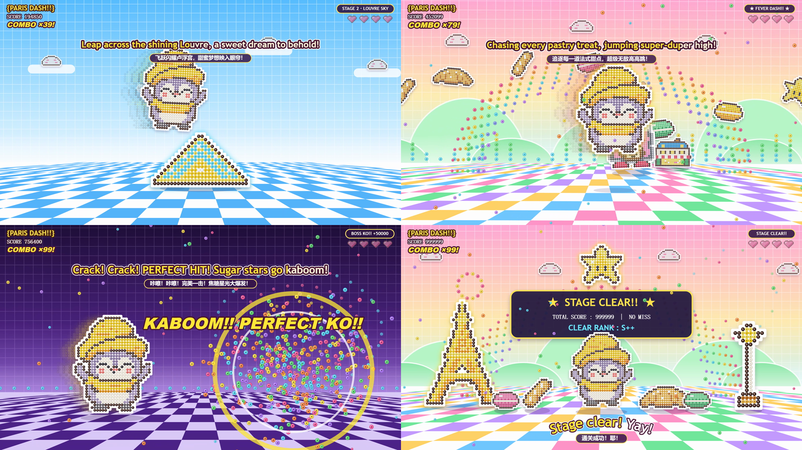
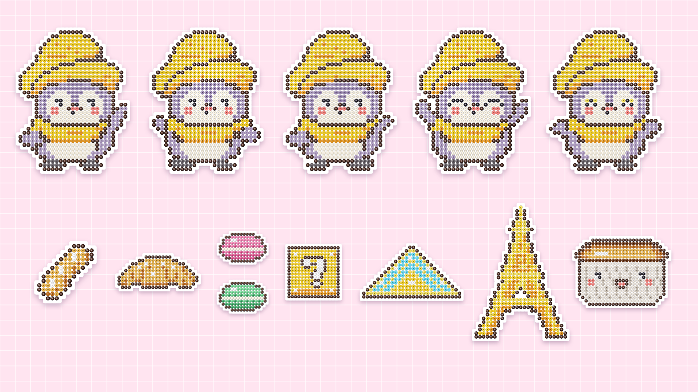

# 🐧 Perler-Bead MV Skill (`perler-bead-mv`)

一套可交互引导的 **Agent Skill**：别人加载这条 Skill 后，AI 会按完整制作流程**一步步提问、引导提供角色图与音乐（或直接给出 Codex / Suno 提示词），自动 1:1 提取拼豆点阵、渲染带塑料豆孔与白色模切贴纸描边的 1080p 像素拼豆游戏风动画 MV**——全程零 AE、零 PR、零手绘！

> An interactive Agent Skill that turns any character concept (or Perler-bead reference photo) + music track into a crisp, zero-blur **1080p glossy Perler-bead pixel-game animation MV** (or 4K die-cut sticker sheet) through step-by-step guided Q&A.



---

## ✨ 亮点 / Highlights

- **全流程交互式引导**：加载后直接说“帮我做一条像素拼豆视频”，Agent 会自动分步询问主角、音乐、主题世界、道具/Boss 和字幕偏好；没有图或歌时直接输出可抄作业的 **Codex 出图提示词** 与 **Suno 配乐提示词**。
- **拒绝“糊马赛克”**：内置真实塑料拼豆渲染器（`scripts/perler_renderer.js`），每颗豆子自带**中心圆孔 + 塑料微高光 + 白色模切贴纸外描边**。
- **1:1 豆格自动提取**：内置零依赖脚本 `scripts/extract_beads.js`，自动识别原图豆距、抠除纯色底并聚类成干净的有限色板。
- **音乐节拍精准卡点**：内置 `scripts/analyze_audio.js`，自动提取音频 BPM、鼓点相位与逐帧能量曲线。
- **先看预览图再渲染**：强制先生成「角色道具贴纸表」与「16 格分镜图」供用户挑刺微调，满意后再由 `scripts/render_mv.js` 渲染 1080p MP4（自动支持 NVIDIA NVENC / Apple VideoToolbox / CPU `libx264`）。



---

## 📦 如何安装使用 / Installation

### Antigravity / Claude Code / Codex / 通用 Agent Skills 目录

将本仓库中的 `skills/perler-bead-mv` 文件夹复制到你的全局或项目 Skills 目录即可：

- **Antigravity（项目级）**：复制到 `<你的项目>/.agents/skills/perler-bead-mv/`
- **Antigravity（全局）**：复制到 `~/.gemini/config/skills/perler-bead-mv/`
- **Claude Code**：复制到 `~/.claude/skills/perler-bead-mv/`
- **Codex**：复制到 `~/.codex/skills/perler-bead-mv/`

或者直接克隆后拷贝：

```bash
git clone https://github.com/xyong934-gif/perler-bead-mv-skill.git
cp -r perler-bead-mv-skill/skills/perler-bead-mv ~/.gemini/config/skills/
```

### 开始使用 / Quick Start

安装完成后，直接对你的 AI 助手说：

> **“用 `perler-bead-mv` 帮我做一个像素拼豆风格的动画视频”**

接下来只需跟着 AI 的提问回答、传图/传歌（或复制它给你的提示词先出图/出歌），看预览图确认满意后即可一键渲染 1080p 成片！

---

## 🗂️ 目录结构 / Repository Structure

```text
perler-bead-mv-skill/
├── README.md
├── LICENSE
├── assets/
│   ├── showcase_preview.png               # 1080p 成品 4 宫格示例
│   └── sprites_preview.png                # 拼豆贴纸角色与道具示例
└── skills/
    └── perler-bead-mv/
        ├── SKILL.md                       # 核心交互引导流程说明
        ├── references/
        │   ├── prompts.md                 # Codex 出图 + Suno 配乐 + 精修口令模板
        │   └── scene-recipes.md           # 马卡龙/星空/Boss 舞台配色与动画玩法指南
        └── scripts/
            ├── extract_beads.js           # 1:1 拼豆点阵与色板自动提取脚本（零 npm 依赖）
            ├── analyze_audio.js           # 音频 BPM / 鼓点 / 逐帧能量分析脚本（零 npm 依赖）
            ├── perler_renderer.js         # 塑料拼豆（孔洞+高光）+ 白色贴纸描边渲染模块
            └── render_mv.js               # Headless Chromium + FFmpeg 1080p 渲染管线
```

## 🛠️ 环境依赖 / Prerequisites

- **Node.js**（v18+，无需 `npm install`）
- **FFmpeg**（用于音视频解析与 1080p 封装）
- **Chrome / Chromium**（用于无头 Canvas 渲染）

## 📄 License

MIT
